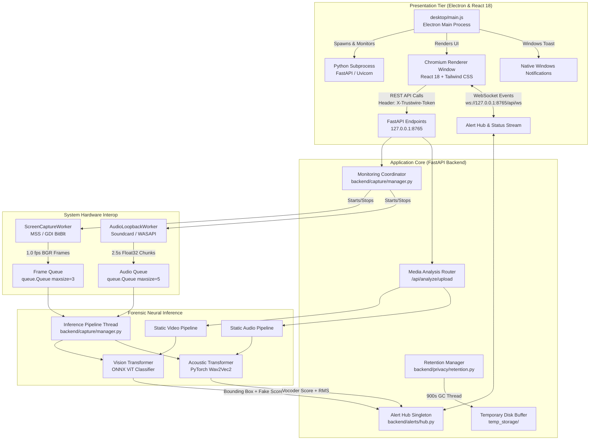

# Trustwire — Complete System Architecture & Concurrency Model

> **Version:** 1.0.0  
> **Target Audience:** Systems Architects, Evaluators, and Technical Viva Judges  
> **Source Grounding:** `desktop/main.js`, `backend/app.py`, `backend/capture/`, `backend/detectors/`  

---

## 1. High-Level Architectural Topology

Trustwire adopts a decoupled, multi-tier desktop architecture designed for resilience, thread safety, and zero external network egress. The system separates the presentation layer (Electron/React) from the intensive forensic compute engine (FastAPI/PyTorch/ONNX Runtime).



---

## 2. Complete Execution Lifecycle: From Boot to Detection

### Phase 1: Application Initialization (`desktop/main.js`)
1. **Host Verification:** Electron checks the Windows environment for Python 3.11 (`LOCALAPPDATA/Programs/Python/Python311/python.exe` or system PATH).
2. **Splash Screen Presentation:** Electron immediately displays a responsive splash window (`SPLASH_HTML`) informing the user that the forensic engines and model weights are loading.
3. **Subprocess Spawning:** Electron launches the FastAPI backend:
   ```powershell
   python -m uvicorn backend.app:app --host 127.0.0.1 --port 8765 --workers 1
   ```
4. **Health Check Polling:** Electron polls `http://127.0.0.1:8765/api/health` every 400ms until a 200 OK is returned.
5. **Main Window Transition:** Once healthy, Electron destroys the splash window and reveals the primary forensic workstation dashboard (`http://localhost:5173` in dev or `file://frontend/dist/index.html` in production).

### Phase 2: Backend Lifespan Setup (`backend/app.py`)
1. **Capability Token Generation:** `backend/config.py` generates or reads `TRUSTWIRE_API_TOKEN` (UUID4).
2. **Startup Retention Recovery:** `retention_manager.run_startup_recovery()` scans `temp_storage/` and deletes any stranded temporary media left by previous ungraceful shutdowns.
3. **Model Warmup & Verification:**
   - `video_detector`: Checks for ONNX weights in `models/video/deepfake_v1` or falls back to HuggingFace cache. Initializes ONNX Runtime Session with multi-threaded CPU execution.
   - `audio_detector`: Checks for PyTorch checkpoint in `models/audio/wav2vec2_v2`. Loads Wav2Vec2 architecture into CPU memory.
4. **Event Loop Binding:** The FastAPI startup event registers the active asyncio loop into `alert_hub.set_event_loop(loop)` to enable threadsafe cross-thread WebSocket broadcasting.

---

## 3. Data Flow & Inter-Process Communication (IPC)

Every data transaction in Trustwire follows strict formatting and typing contracts:

| Hop / Boundary | Sender Module | Receiver Module | Protocol / Format | Data Payload Description |
| :--- | :--- | :--- | :--- | :--- |
| **A1: Auth & Health** | React `api.ts` | FastAPI `app.py` | HTTP GET `/api/health` | Headers: `X-Trustwire-Token`. Returns detector readiness states. |
| **A2: Live Toggle** | React `LiveMonitoring.tsx` | FastAPI `app.py` | HTTP POST `/api/monitoring/start` | JSON: `{video_enabled: true, audio_enabled: true, monitor_index: 1}`. |
| **B1: Screen Frame** | `ScreenCaptureWorker` | `LiveMonitoringCoordinator` | In-Memory `queue.Queue` | Tuple: `(frame_bgr: np.ndarray, timestamp: float)`. Shape: `(H, W, 3)` uint8. |
| **B2: Audio Buffer** | `AudioLoopbackWorker` | `LiveMonitoringCoordinator` | In-Memory `queue.Queue` | Dict: `{"samples": np.ndarray, "rms": float, "has_signal": bool}`. 16kHz float32. |
| **C1: Face Crop** | Video Preprocessor | ONNX Runtime ViT | Preprocessed Tensor | Shape: `(1, 3, 224, 224)` float32. Normalized to $[-1.0, 1.0]$. |
| **C2: Audio Tensor**| Audio Preprocessor | PyTorch Wav2Vec2 | PyTorch Tensor | Shape: `(1, 48000)` float32. 3.0-second waveform window. |
| **D1: Forensic Alert**| Detector Engines | `AlertHub` Singleton | Internal Method Call | Object: `AlertItem(category, severity, title, evidence, score)`. |
| **D2: WebSocket Push**| `AlertHub` | React `App.tsx` | WebSocket JSON | `{"type": "ALERT", "alert": {...}}` broadcast to all connected UI clients. |
| **D3: Native Toast** | React `App.tsx` | Electron `main.js` | Electron IPC `show-notification` | Displays native Windows notification balloon in action center. |

---

## 4. Concurrency & Threading Model

Trustwire manages a sophisticated multi-threaded runtime to maintain 60 fps UI responsiveness while performing computationally heavy neural inference:

```
+-----------------------------------------------------------------------------------+
|                            PYTHON BACKEND PROCESS                                 |
|                                                                                   |
|  +-----------------------------------------------------------------------------+  |
|  | Thread 1: Main Event Loop (AsyncIO / Uvicorn Server)                        |  |
|  | - Handles incoming HTTP requests and WebSocket connections                   |  |
|  | - Dispatches alerts to UI clients via WebSocket event queues                |  |
|  +-----------------------------------------------------------------------------+  |
|                                                                                   |
|  +-----------------------------------------------------------------------------+  |
|  | Thread 2: Screen Capture Worker (MSS Desktop Grabber)                       |  |
|  | - Invokes Windows GDI / BitBlt capture at 1.0s intervals                     |  |
|  | - Drops stale frames if FrameQueue reaches capacity (size=3)               |  |
|  +-----------------------------------------------------------------------------+  |
|                                                                                   |
|  +-----------------------------------------------------------------------------+  |
|  | Thread 3: Audio Loopback Worker (WASAPI Soundcard Streamer)                 |  |
|  | - Streams raw float32 audio buffers from Windows default speaker output     |  |
|  | - Calculates RMS energy; pushes 2.5s chunks to AudioQueue (size=5)          |  |
|  +-----------------------------------------------------------------------------+  |
|                                                                                   |
|  +-----------------------------------------------------------------------------+  |
|  | Thread 4: Live Inference Coordinator Loop (CPU Compute Engine)              |  |
|  | - Dequeues screen frames -> Haar cascade -> Skin filter -> ONNX ViT        |  |
|  | - Dequeues audio chunks -> RMS filter -> PyTorch Wav2Vec2                   |  |
|  | - Evaluates disparity scores and triggers alerts via AlertHub               |  |
|  +-----------------------------------------------------------------------------+  |
|                                                                                   |
|  +-----------------------------------------------------------------------------+  |
|  | Thread 5: Privacy Retention Cleaner (Daemon)                                |  |
|  | - Wakes up every 30 seconds                                                 |  |
|  | - Purges artifacts with (CurrentTime - ArtifactTime) > 900 seconds          |  |
|  +-----------------------------------------------------------------------------+  |
+-----------------------------------------------------------------------------------+
```

---

## 5. Architectural Distinctions: Key Concepts Explained

### 1. UI Code vs Backend Logic
- **UI Code (`frontend/src/`):** Executes inside the Chromium browser sandbox. Responsible exclusively for rendering state, animating graphs, managing user interactions, and styling. Has no access to raw files or Windows C++ APIs.
- **Backend Logic (`backend/`):** Runs in a native Python 3.11 environment with full access to Windows APIs (`ctypes`, `mss`, `soundcard`), native neural runtimes (ONNX, PyTorch), and local filesystem paths.

### 2. Synchronous vs Asynchronous Execution
- **Asynchronous (`async`/`await`):** Used for non-blocking I/O operations in FastAPI (handling WebSocket connections, streaming HTTP responses, receiving multipart file uploads).
- **Synchronous / Multi-Threaded:** Used for CPU-bound neural model inference. If model inference ran inside the async event loop, it would block the server, freezing the UI and causing WebSocket disconnects. By delegating capture and inference to dedicated OS threads (`threading.Thread`), the async loop remains completely responsive.

### 3. Model Wrapper vs Underlying Model
- **Underlying Model (`onnxruntime.InferenceSession`, `transformers.Wav2Vec2ForSequenceClassification`):** Raw neural network weights and mathematical compute graph. Accepts only numerical multidimensional tensors; outputs raw uncalibrated logits.
- **Model Wrapper (`VideoDeepfakeDetector`, `AudioDeepfakeDetector`):** Comprehensive engineering harness encapsulating file decoding, format conversion, face detection, skin filtering, silence gating, logit softmax transformation, confidence calibration, temporal chunk voting, and human-readable evidence synthesis.

### 4. Raw Media vs Preprocessed Tensors vs Model Scores vs Decisions
- **Raw Media:** A 1080p MP4 file on disk or a 1920x1080 BGR screen grab.
- **Preprocessed Tensor:** A standardized 4D array `(1, 3, 224, 224)` scaled to $[-1.0, 1.0]$.
- **Model Score:** Raw probabilistic scalar output from the neural network (e.g., $P(\text{Fake}) = 0.742$).
- **Final Decision:** Forensic verdict generated by temporal thresholding rules (e.g., *"Potentially manipulated (Confidence: 81.2%)"* with bounding box coordinates and timestamps).
