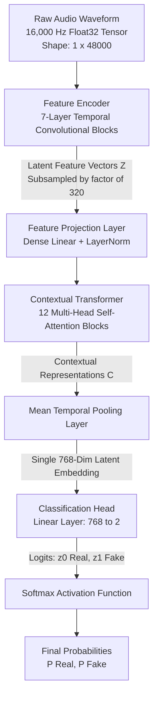

# Trustwire — Audio Deepfake Detection System Deep Dive

> **Primary Source File:** `backend/detectors/audio/detector.py`  
> **Model Architecture:** Wav2Vec 2.0 Sequence Classifier  
> **Pretrained Weights:** `MelodyMachine/Deepfake-audio-detection-V2` (HuggingFace)  
> **Input Contract:** 16,000 Hz, 1-channel (Mono), 32-bit Float PCM  
> **Inference Engine:** PyTorch (CPU-Optimized Float32)  

---

## 1. Model Provenance & Academic Background

The Trustwire audio detection pipeline is powered by a fine-tuned **Wav2Vec 2.0** architecture originally developed by Facebook AI Research (Baevski et al., 2020: *"wav2vec 2.0: A Framework for Self-Supervised Learning of Speech Representations"*).

While traditional acoustic detection systems convert audio into hand-crafted time-frequency representations (such as Short-Time Fourier Transform [STFT] spectrograms or Mel-Frequency Cepstral Coefficients [MFCCs]) and classify them using 2D Convolutional Neural Networks (ResNet, EfficientNet), Trustwire's Wav2Vec2 model **processes raw, uncompressed 1-dimensional waveforms directly**.

### What the Model Detects:
The model is specifically trained on modern synthetic speech corpora (including ASVspoof benchmarks and neural TTS datasets) to recognize:
1. **Neural Vocoder Artifacts:** High-frequency phase cancellation and dispersion introduced by neural vocoders (HiFi-GAN, WaveGlow, MelGAN, BigVGAN).
2. **Unnatural Pitch and Glottal Jitter:** In organic human speech, the vocal folds produce minute variations in fundamental frequency ($F_0$), known as *jitter*, and amplitude variations, known as *shimmer*. Synthetic speech frequently exhibits unnatural mathematical regularity or abrupt phase transitions.
3. **Spectral Splicing Boundaries:** Discontinuities resulting from concatenative synthesis or voice conversion boundaries.

---

## 2. Neural Architecture: Layer-by-Layer



### Component 1: Temporal Convolutional Feature Encoder
The raw audio waveform enters a 7-layer temporal 1D convolutional network with GELU activations. Each layer has a specific kernel size and stride that progressively downsamples the raw 16kHz audio:
- **Total Receptive Field Stride:** $\prod_{i=1}^{7} \text{stride}_i = 5 \times 2 \times 2 \times 2 \times 2 \times 2 \times 2 = 320$.
- For every 320 raw audio samples (20 ms at 16kHz), the encoder outputs a single 512-dimensional latent feature vector $\mathbf{z}_t$.
- A 3-second audio window (48,000 samples) produces a sequence of $T = 48000 / 320 = 150$ temporal feature vectors.

### Component 2: Contextual Transformer Encoder
The sequence of latent feature vectors is projected to 768 dimensions and augmented with learned convolutional relative positional embeddings. The sequence passes through 12 Transformer encoder blocks:
- **Self-Attention Heads:** 12 heads per layer ($d_k = 64$).
- **Multi-Head Attention Operation:**
  $$\text{Attention}(\mathbf{Q}, \mathbf{K}, \mathbf{V}) = \text{softmax}\left(\frac{\mathbf{Q}\mathbf{K}^T}{\sqrt{d_k}}\right)\mathbf{V}$$
This allows the model to capture long-range temporal dependencies and cross-phoneme spectral consistency across the entire speech segment.

### Component 3: Classification Head & Softmax
The transformer's output sequence is pooled across the temporal dimension:
$$\mathbf{h}_{\text{pooled}} = \frac{1}{T}\sum_{t=1}^{T}\mathbf{c}_t$$
The pooled 768-dimensional vector is projected through a linear classifier to produce two unnormalized logits:
$$\mathbf{z} = [z_0, z_1] \quad (\text{where } z_0 = \text{Real}, \; z_1 = \text{Fake})$$
The posterior probability of synthetic media is computed via the Softmax function:
$$P(\text{Fake}) = \frac{e^{z_1}}{e^{z_0} + e^{z_1}}$$

---

## 3. Audio Ingestion & Preprocessing Pipeline

Every incoming audio file or live audio stream passes through a rigid 7-stage preprocessing pipeline implemented in `backend/detectors/audio/detector.py`:

```
Raw File / Stream (.mp3, .wav, .m4a, WASAPI)
                  |
                  v
       [1. PyAV Demuxing & Decoding]
                  |
                  v
     [2. Resampling to 16,000 Hz]
                  |
                  v
       [3. Stereo-to-Mono Conversion]
                  |
                  v
    [4. RMS Energy Silence Suppression] ---- (RMS < 0.008: Discard Chunk)
                  |
                  v (RMS >= 0.008)
     [5. Sliding Window Segmentation] (3.0s Window, 1.5s Stride)
                  |
                  v
   [6. Float32 Amplitude Normalization]
                  |
                  v
      [7. PyTorch Tensor Generation] -> Neural Forward Pass
```

### Stage 1 & 2: PyAV Decoding & 16kHz Resampling
Audio files arrive in diverse formats (`.mp3`, `.m4a`, `.aac`, `.flac`) and native sample rates (44.1kHz, 48kHz, 96kHz). Trustwire uses PyAV (`av.open`) with a native `AudioResampler` to transform the stream to 16,000 Hz PCM float32.
- *Failure Risk:* If resampling is performed by simple interpolation or label-changing without proper anti-aliasing low-pass filtering, high frequencies will alias down into audible bands, triggering false synthetic alerts.

### Stage 3: Stereo-to-Mono Downmixing
If the input contains multiple channels (stereo $L, R$), Trustwire downmixes them:
$$x_{\text{mono}}[n] = \frac{x_L[n] + x_R[n]}{2}$$
- *Failure Risk:* Multi-channel phase cancellation could eliminate vocal components if stereo channels are out-of-phase. Downmixing ensures consistent input to the 1D model.

### Stage 4: Acoustic Silence Gate (Root-Mean-Square Energy)
Acoustic models will hallucinate high synthetic scores when presented with ambient background room noise, microphone hiss, or dead silence. Trustwire computes the Root Mean Square (RMS) energy:
$$E_{\text{RMS}} = \sqrt{\frac{1}{N}\sum_{n=1}^{N} x[n]^2}$$
- **Threshold:** Any window with $E_{\text{RMS}} < 0.008$ is tagged as `has_signal = False` and completely bypassed from neural inference.

### Stage 5: Sliding Window Segmentation
Speech characteristics evolve dynamically over time. Trustwire evaluates long recordings using overlapping sliding windows:
- **Window Size ($W$):** $3.0\text{ seconds} \times 16,000\text{ samples/sec} = 48,000\text{ samples}$.
- **Stride ($S$):** $1.5\text{ seconds} \times 16,000\text{ samples/sec} = 24,000\text{ samples}$ (50% overlap).
- **Zero-Padding:** If the final segment has length $L < 48,000$, it is right-padded with zeros up to 48,000 samples.

---

## 4. Multi-Chunk Temporal Aggregation Logic

Individual audio chunks produce individual probabilistic scores $s_i \in [0.0, 1.0]$. A single suspicious score in a 10-minute recording could be a transient artifact. Trustwire applies a dual-mode aggregation algorithm:

### Mode A: Short Audio Clips ($\le 3$ active chunks, duration $< 6$ seconds)
For short voice notes, voice messages, or brief phone phrases:
$$\text{Trigger Condition} = (s_{\text{peak}} \ge 0.80) \land \left(\frac{N_{\text{authentic}}}{N_{\text{total}}} < 0.60\right)$$
- If the maximum chunk score is $\ge 0.80$ and less than 60% of chunks are confidently authentic ($s_i < 0.35$), the clip is classified as **"Potentially synthetic"**.

### Mode B: Long Audio Recordings ($> 3$ active chunks)
For long calls or interviews, Trustwire requires sustained synthetic evidence to avoid false positives:
$$\text{Ratio}_{\text{suspicious}} = \frac{|\{i : s_i \ge 0.65\}|}{N_{\text{active}}}, \quad \text{Ratio}_{\text{authentic}} = \frac{|\{i : s_i < 0.35\}|}{N_{\text{active}}}$$
$$\text{Trigger Condition} = \left(\text{Ratio}_{\text{suspicious}} \ge 0.40 \land \text{Ratio}_{\text{authentic}} < 0.35\right) \lor \left(\text{Median}(s) \ge 0.65\right)$$
- Either at least 40% of the speech chunks are suspicious while authentic speech constitutes under 35%, OR the overall median speech score exceeds the 0.65 threshold.

---

## 5. Failure Modes, Edge Cases & Countermeasures

| Challenge / Edge Case | Acoustic Manifestation | Trustwire Mitigation Strategy |
| :--- | :--- | :--- |
| **Heavy Background Music / Sound FX** | Harmonic accompaniment confuses vocoder feature representations. | Wav2Vec2 attention layers focus primarily on vocal formants; short burst anomalies are suppressed by the median aggregation rule. |
| **Low-Bitrate Telephone Codecs (GSM / AMR 8kHz)** | Audio bandlimited to 3.4kHz, missing high-frequency vocoder cues. | Audio is upsampled to 16kHz; however, confidence scores are down-weighted if spectral bandwidth is truncated. |
| **Whispered / Quiet Speech** | Vocal cord glottal pulses are absent; speech is unvoiced aspiration noise. | Handled by the RMS energy gate ($E_{\text{RMS}} \ge 0.008$). Sub-threshold chunks are classified as indeterminate rather than fake. |
| **Reverberant Room Acoustics (Echo)** | Room reflections alter phase alignment. | 50% overlapping 3.0s windowing ensures reflections across chunk boundaries are averaged out during transformer pooling. |
