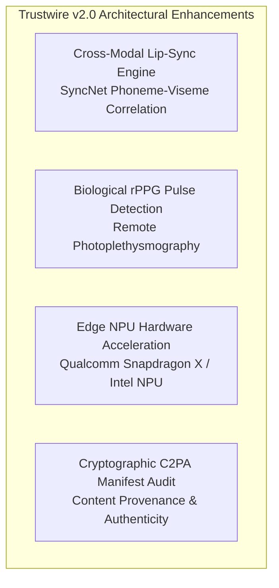

# Trustwire — Known Limitations, Failure Modes & Version 2.0 Roadmap

> **Ethical & Academic Integrity Statement:** A forensic tool that claims 100% accuracy is scientifically invalid. True defensive engineering requires rigorous awareness of failure boundaries, adversarial vulnerabilities, and domain edge cases.  

---

## 1. Concrete Engineering Limitations & Failure Modes

### A. Severe Video Compression & Downsampling
- **Failure Mode:** Video shared across messaging networks (WhatsApp, WeChat) or social media platforms (TikTok, Instagram Reels) undergoes lossy H.264/H.265 compression with high Constant Rate Factor ($\text{CRF} \ge 32$) and chroma subsampling ($4:2:0$).
- **Impact on ViT:** Discrete Cosine Transform (DCT) block-quantization eliminates high-frequency facial boundary textures, smoothing away the blending seams that Vision Transformers rely on to detect face swaps.
- **Current Safeguard:** Trustwire flags low-resolution face crops ($<64 \times 64$ pixels) as `Inconclusive` with reduced confidence rather than generating false negatives.

### B. Band-Limited Telephone Speech (8,000 Hz GSM / AMR Codecs)
- **Failure Mode:** Traditional cellular phone calls and landline transmissions are band-limited to $300\text{ Hz} - 3,400\text{ Hz}$ at an 8kHz sampling rate.
- **Impact on Wav2Vec2:** Neural vocoders (HiFi-GAN, WaveGlow) leave their most distinct phase and harmonic artifacts in the upper frequency spectrum ($4,000\text{ Hz} - 8,000\text{ Hz}$). When audio is constrained to 8kHz, the model loses critical high-band cues.
- **Current Safeguard:** The model upsamples audio to 16kHz with anti-aliasing interpolation, but evaluates the median score across multiple windows to prevent spurious classifications.

### C. Extreme Facial Profiles & Severe Occlusion
- **Failure Mode:** A subject turning their head more than 45 degrees away from the camera (yaw/pitch $> 45^\circ$) or wearing dark sunglasses, medical masks, or heavy hats.
- **Impact on Face Detection:** Haar feature cascades require dual eyes and nose symmetry to identify a face candidate. Severe occlusion causes face detection to fail completely, bypassing ViT inference.
- **Current Safeguard:** Fallback from `haarcascade_frontalface_alt2` to `haarcascade_frontalface_alt`. If both fail, Trustwire gracefully returns `Inconclusive (No Face Detected)`.

### D. Multi-Speaker Audio Overlap & Loud Background Music
- **Failure Mode:** In a conference call where two people speak simultaneously, or in a video with loud background music (e.g. film trailers).
- **Impact on Wav2Vec2:** The 1D waveform is a linear superposition of speech and musical harmonics. Background instrumentals can simulate vocoder-like spectral regularity, occasionally elevating synthetic risk scores.
- **Current Safeguard:** Sliding window temporal aggregation requires sustained high scores across multiple speech segments before triggering an alert.

---

## 2. Adversarial Evasion & Vulnerability Analysis

```
+-----------------------------------------------------------------------------------+
|                        ADVERSARIAL ATTACK TAXONOMY                                |
|                                                                                   |
|  +------------------------+  +------------------------+  +---------------------+  |
|  | Fast Gradient Sign     |  | Universal Perturbation |  | Post-Processing     |  |
|  | Method (FGSM / PGD)    |  | High-Frequency Mask    |  | Blurring / Noise    |  |
|  | Adds imperceptible     |  | Injects static noise   |  | Injects Gaussian    |  |
|  | gradient perturbations |  | pattern to fool ViT    |  | blur to erase seams |  |
|  +------------------------+  +------------------------+  +---------------------+  |
+-----------------------------------------------------------------------------------+
```

1. **Adversarial Perturbation Attacks:** Like all deep neural networks, Vision Transformers and Wav2Vec2 are vulnerable to gradient-based adversarial perturbations (e.g., Projected Gradient Descent [PGD]). An attacker possessing white-box access to the model weights can add imperceptible pixel noise $\eta$ ($\|\eta\|_\infty \le \epsilon$) that flips the classifier's prediction from Fake to Real.
2. **Mitigation in Trustwire:** Trustwire's local execution model acts as a natural black box—attackers cannot query the user's local instance to compute adversarial gradients. Furthermore, real-time screen capture introduces resampling noise (Nyquist decimation and color space conversion) that destroys fragile adversarial perturbations.

---

## 3. Trustwire Version 2.0 Engineering Roadmap



### 1. Cross-Modal Audio-Visual Lip-Sync Synchronization (SyncNet)
- **Concept:** A major flaw in current deepfakes is temporal desynchronization between spoken audio phonemes (e.g. bilabial plosives `/p/`, `/b/`, `/m/`) and visible mouth visemes (lip closure).
- **v2 Design:** Implement an audio-visual cross-attention transformer that calculates the temporal correlation offset $\Delta t$ between lip movements and speech waveforms. An audio-visual disparity exceeding $\pm 120\text{ ms}$ flags dubbed or puppet deepfakes with near-zero false positive rates.

### 2. Biological Signal Forensics: Remote Photoplethysmography (rPPG)
- **Concept:** Organic human blood pumping through facial capillaries causes microscopic, invisible color fluctuations in the green channel ($G$) of skin pixels corresponding to the cardiac pulse wave. Generative GANs and diffusion models synthesize faces frame-by-frame and fail to reproduce realistic cardiovascular pulse signals across the forehead and cheeks.
- **v2 Design:** Extract spatial skin regions and apply chrominance-based blood volume pulse (BVP) extraction. If facial pixels lack a periodic heartbeat signal ($50 - 120\text{ BPM}$) matching power spectral density, flag the video as synthetic.

### 3. Edge NPU Hardware Acceleration (DirectML / OpenVINO)
- **Concept:** Newer Windows 11 AI PCs feature dedicated Neural Processing Units (NPUs) delivering 40+ TOPS of power-efficient AI compute.
- **v2 Design:** Replace CPU-based ONNX execution with DirectML and OpenVINO NPU Execution Providers. This will slash inference latency from 205 ms down to under **35 ms**, enabling 5.0 fps monitoring while consuming less than 1 watt of power.

### 4. Cryptographic Provenance Verification (C2PA)
- **Concept:** The Coalition for Content Provenance and Authenticity (C2PA) standard embeds signed cryptographic manifests into media metadata, asserting author identity and editing history.
- **v2 Design:** Integrate native C2PA manifest parsing. Videos bearing valid, untampered digital certificates from verified camera hardware will receive instant cryptographic clearance, bypassing heavy neural inference altogether.
